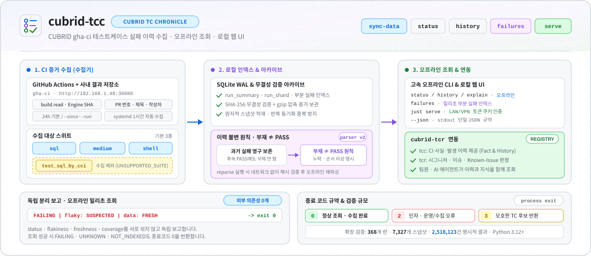
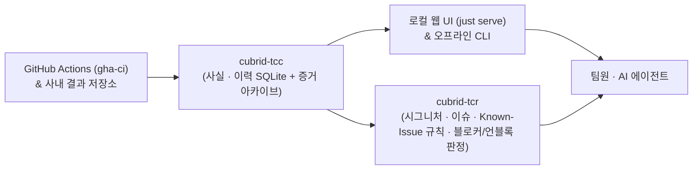
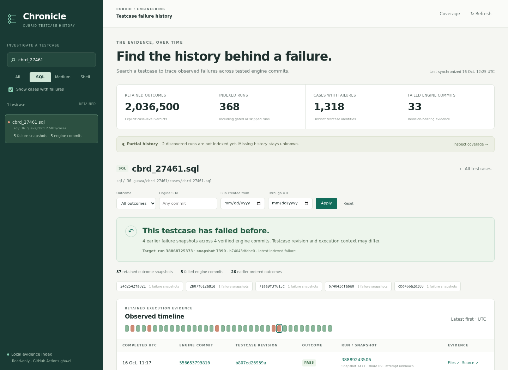

<div align="center">

<picture>
  <source media="(prefers-color-scheme: dark)" srcset="assets/readme/hero-dark.svg">
  <source media="(prefers-color-scheme: light)" srcset="assets/readme/hero-light.svg">
  
</picture>

# CUBRID TC Chronicle (cubrid-tcc)

**CUBRID GitHub Actions (`gha-ci`) 테스트케이스 실패 이력을 수집해 오프라인 CLI와 로컬 웹 UI로 1초 만에 조회하는 CI 이력 기록관**

[한눈에 보기](#한눈에-보기--왜-만들었나요) ·
[tcc vs tcr](#cubrid-tcc-vs-cubrid-tcr-둘은-어떻게-다른가요) ·
[웹 UI](#웹-ui-미리보기-just-serve) ·
[설치 및 타이머](#빠른-시작--설치) ·
[주요 명령어](#상황별-주요-명령어) ·
[AI 에이전트 연동](#ai-에이전트--자동화-연동) ·
[증거 원칙과 한계](#증거-원칙과-현재-한계) ·
[개발 및 문서](#개발-및-상세-문서)

</div>

---

## 한눈에 보기 — 왜 만들었나요?

PR CI에서 테스트케이스(TC)가 하나 깨졌을 때, 팀원이 가장 먼저 확인하고 싶은 질문은 단순합니다.

> *"이 테스트가 내 PR 때문에 새로 깨진 건가요, 아니면 `develop`이나 다른 PR에서도 원래 깨지던 건가요? 간헐적(flaky)인 건가요?"*

GitHub Actions 화면만으로는 과거 여러 PR·커밋에 걸친 TC별 이력을 한눈에 추적하기 어렵고, 재실행(rerun)이나 결과 디렉토리 덮어쓰기가 일어나면 이전 실패 맥락이 흐려집니다. **CUBRID TC Chronicle (`cubrid-tcc`, 버전 0.3.0)**은 `gha-ci`의 `sql`, `medium`, `shell` 실행 결과와 PR 메타데이터를 로컬 SQLite WAL 인덱스와 무결성 검증 아카이브에 차곡차곡 축적해, 네트워크 없이도 다음 7가지 질문에 즉시 근거와 함께 답합니다.

1. **최신 관측 판정 및 최근 실패 건수**: 최근 기간/범위에서 이 TC의 최신 판정(`FAILING`, `PASSING`, `MIXED`, `UNKNOWN`, `NOT_INDEXED`)과 실패 런/건수는 몇 건인가요?
2. **Flakiness 의심 여부**: 동일한 엔진 SHA, TC SHA, 빌드 모드, 실행 variant, CTP SHA, 플랫폼, 설정 다이제스트 조건에서 독립된 `PASS`와 `FAIL`/`ERROR`가 공존하나요?
3. **실패한 엔진 커밋 목록**: 이 실패가 관측된 엔진 커밋 SHA들은 무엇인가요?
4. **PR 번호와 작성자**: 어떤 PR의 CI 런에서 실패가 기록되었고, 누가 그 PR을 올렸나요?
5. **선행 실패 여부**: 선택한 발생 시점 이전에도 동일한 TC가 실패한 적이 있나요? (`SEEN_BEFORE` / `FIRST_OBSERVED_IN_WINDOW` / `UNKNOWN_HISTORY`)
6. **원본 결과 및 실패 상세 경로**: 압축 보관된 원본 결과 파일(`summary_info`, JUnit 등)과 해시 검증된 증거를 어디서 확인할 수 있나요?
7. **수집 범위·누락·미인덱싱 현황**: 관련 이력 중 얼마나 수집되었고, 빠진 런이나 샤드 또는 미인덱싱 구간은 어디인가요?

---

## `cubrid-tcc` vs `cubrid-tcr`, 둘은 어떻게 다른가요?

CUBRID CI 분석 도구는 **사실·이력을 기록하는 `cubrid-tcc`**와 **사람·에이전트가 축적한 지식과 Known-Issue 판정을 관리하는 `cubrid-tcr`**로 역할이 명확히 나뉩니다.

| 구분 | `cubrid-tcc` (CUBRID TC Chronicle) | `cubrid-tcr` ([`vimkim/cubrid-tc-registry`](https://github.com/vimkim/cubrid-tc-registry)) |
|---|---|---|
| **역할** | **CI 사실·이력 기록관** (Fact & History) | **큐레이션 지식 저장소·판정관** (Knowledge, Known-Issue & Blocker Verdict) |
| **저장 내용** | GitHub Actions `gha-ci` 런 메타데이터, 스위트/샤드 스냅샷, TC별 `PASS`/`FAIL`/`ERROR`/`SKIP`/`NOT_RUN` 이력, PR 번호·제목·작성자·브랜치, SHA-256 검증 gzip 원본 증거 | 실패 시그니처(스택 프레임/NOK 텍스트), 이슈 링크(`origin`/`tracks`/`suspected`/`fixed_by`), 분석 메모, 승인된 Known-Issue 규칙, 블로커·수정 PR·담당자 추적 |
| **누가 쓰나요** | CI 수집기(`sync-data` / `systemd` 타이머)가 자동 적재하고, 팀원·`cubrid-tcr`·AI 에이전트가 오프라인으로 조회 | 팀원·AI 에이전트가 시그니처·메모·이슈 링크·블로커를 축적 (`rule` 승인은 사람만 수행) |
| **대표 질문** | *"이 TC가 최근 14일간 언제, 어떤 커밋/PR에서 깨졌고 간헐적(flaky)인가요?"* | *"이 스택/NOK 에러는 이미 알려진 이슈(Known-Issue)인가요? 수정 커밋이 들어갔나요?"* |



---

## 웹 UI 미리보기 (`just serve`)



로컬에 수집된 SQLite 인덱스를 브라우저에서 탐색하려면 읽기 전용 웹 UI를 띄웁니다. CLI와 완전히 동일한 이력·커버리지 정책을 사용하며, 외부 런타임 패키지 없이 Python 표준 라이브러리와 정적 HTML/CSS/JS로 동작합니다.

```sh
# 모든 활성 인터페이스(LAN, VPN, loopback)에 바인딩하고 접속 URL 출력
just serve

# 내 컴퓨터(127.0.0.1)에서만 접근하도록 실행 (원격 서버에서는 SSH 포트 포워딩 권장)
just serve-local

# 포트 지정 또는 별도 인덱스 지정
just serve --port 8877
just cubrid-tcc --data-dir /path/to/index serve --port 8765
```

- **LAN / VPN 접속 & 보안**: `just serve`는 Linux `iproute2`(`ip`)로 활성 LAN/VPN/루프백 주소를 탐지해 **임시 토큰이 포함된 URL**을 터미널에 출력합니다(브라우저를 자동으로 열지 않습니다). 최초 접속 시 서버가 임시 토큰을 **HTTP-only, `SameSite=Strict` 세션 쿠키**로 교환하고 URL에서 토큰을 제거합니다. 서버를 재시작할 때마다 새 토큰이 발급됩니다.
- **UI 내 기능**: 티켓/파일명/경로 검색, 스위트 필터, 특정 실패를 조사 기준(`Use as target`)으로 선택해 선행 실패 여부 확인, 엔진 SHA·결과·UTC 날짜 필터링, 체크섬이 검증된 보존 파일(`Retained bytes`)과 원본 URL(`Original source`) 열람, 그리고 **Coverage** 탭의 누락 점검을 지원합니다.
- **PR 메타데이터 보강**: 신규 수집에는 PR 번호·제목·작성자·`base`/`head` 브랜치가 자동 포함됩니다. 과거에 수집한 이력에 PR 상세 정보만 보강하려면 TC 결과 재다운로드 없이 아래 명령을 실행하세요.

```sh
just sync-data --pr-metadata-only
```

---

## 빠른 시작 & 설치

### 사전 요구사항

- **OS / Python**: Linux, **Python 3.12+**
- **도구**: [`uv`](https://docs.astral.sh/uv/), [`just`](https://github.com/casey/just), 인증 완료된 GitHub CLI (`gh`)
- **네트워크(수집 시)**: GitHub API 및 사내 CUBRID 결과 저장소(`TCC_STORE_URL`) 접근

### 설치 및 첫 수집·조회

```sh
# 1. 개발/실행 환경 구성
just setup

# 2. 사용자 PATH에 cubrid-tcc CLI 및 AI 에이전트 스킬 설치 (반드시 기본 main 체크아웃에서 실행)
just install   # `just sync`의 별칭; 스킬만 갱신할 때는 `just install-skills`

# 3. 특정 CI 런 1건 수집 (GitHub + 사내 결과 저장소 접근)
just sync-data --run 38868725373

# 4. 오프라인 고속 조회 (로컬 SQLite 인덱스만 사용)
cubrid-tcc status cbrd_27461 --json
cubrid-tcc failures --days 7 --suite sql --json
just find cbrd_27461
just history sql/_36_guava/cbrd_27461/cases/cbrd_27461.sql
just explain --run 38868725373 --suite sql \
  --case sql/_36_guava/cbrd_27461/cases/cbrd_27461.sql
```

- `just install`(`just sync` 별칭)은 `main` 브랜치의 기본 체크아웃에서 `uv tool install --reinstall .`와 `just install-skills`를 함께 실행해 `cubrid-tcc` CLI와 동봉된 AI 에이전트 스킬([`skills/cubrid-tcc/SKILL.md`](skills/cubrid-tcc/SKILL.md) → `~/.agents/skills`, `~/.codex/skills`, `~/.claude/skills`)을 한 번에 설치합니다. 스킬 파일만 다시 설치하려면 `just install-skills`를 실행하세요.
- 과거 `tcc` 실행 파일은 **`cubrid-tcc`로 대체**되었으며 별도 `tcc` 별칭은 설치하지 않습니다. 기존 스크립트나 에이전트 지침에 `tcc` 또는 `just tcc`가 있다면 `cubrid-tcc`, `just cubrid-tcc`로 바꾸세요. (로컬 인덱스, `TCC_DATA_DIR`, `TCC_STORE_URL` 설정은 그대로 유지됩니다.)
- `daily-update` 연동 환경에서는 clean `main` 체크아웃을 자동 pull한 뒤 `just sync`를 갱신합니다. (데이터 수집 `sync-data`는 별도 실행입니다.)
- 레거시 `cubrid-tcc sync` 서브커맨드는 `sync-data`의 하위 호환 별칭으로 남아 있으며 stderr에 마이그레이션 안내를 출력합니다.

### `systemd --user` 1시간 주기 자동 수집 설정

매시간 최근 `gha-ci` 런을 백그라운드에서 자동 수집하려면 사용자 systemd 타이머를 등록할 수 있습니다. (사전에 `just sync`를 실행해 `cubrid-tcc`와 인증된 `gh`가 `PATH`에 있어야 합니다.)

```sh
# 1. 서비스/타이머 유닛 설치 (설치 시점의 PATH 기록)
just install-timer

# 2. 타이머 활성화 및 즉시 시작
systemctl --user enable --now cubrid-tcc-sync.timer

# 3. 타이머 상태 및 최근 수집 로그 확인
just timer-status
just timer-logs
```

- 커스텀 인덱스 경로나 저장소 URL, GitHub CLI 설정을 쓰려면 `${XDG_CONFIG_HOME:-$HOME/.config}/cubrid-tc-chronicle/sync.env` 파일에 `NAME=value` 형식으로 지정하세요.
  - `TCC_DATA_DIR`: 로컬 인덱스 경로 (기본값: `${XDG_DATA_HOME:-$HOME/.local/share}/cubrid-tc-chronicle`)
  - `TCC_STORE_URL`: 사내 결과 저장소 URL (`sync-data` 시 필수 — `--store`, 환경변수 또는 `sync.env`로 설정)
  - `GH_CONFIG_DIR`: `gh` 인증 설정 디렉토리
- SSH 로그아웃 후에도 타이머가 계속 돌려면 계정에 systemd linger(`loginctl enable-linger $USER`)가 활성화되어 있어야 합니다.
- 중지하려면 `systemctl --user disable --now cubrid-tcc-sync.timer`를 실행하세요.

---

## 상황별 주요 명령어

모든 `just <recipe>`는 인자를 그대로 `cubrid-tcc`에 전달합니다. `--data-dir`이나 `--repository` 같은 전역 옵션은 서브커맨드 **앞**에 두어야 하며(`just cubrid-tcc --data-dir ...`), `--json`은 앞뒤 어느 쪽에 두어도 동작합니다.

| 상황 | 명령어 | 핵심 동작 및 옵션 |
|---|---|---|
| **TC 현재 상태 요약** | `cubrid-tcc status <CASE>` | 기본 최근 **14일** 기준 최신 판정, 카운트, flakiness 의심 여부, 신선도(`freshness`), 커버리지 요약 (`--pr`, `--branch`, `--engine`, `--days`, `--since`/`--until`, `--variant`, `--max-age-hours`, `--limit`) |
| **최근/PR별 실패 목록 고속 조회** | `cubrid-tcc failures` | 부분 실패 인덱스(`observation_failures`)를 사용해 **밀리초 단위**로 `FAIL`/`ERROR` 목록 조회 (`--pr 8753 --latest-run --json`, `--days 7 --suite shell`, `--run`, `--case`, `--since`/`--until`, `--limit`) |
| **모호한 TC 이름 찾기** | `cubrid-tcc find <TERM>` | 티켓 번호, 파일명, 경로 조각(대소문자 무시)으로 후보 경로·스위트·variant 탐색 (`--suite`, `--variant`, `--coverage compact\|full`) |
| **전체 실패 이력·커밋 추적** | `cubrid-tcc history <CASE>` | 기간 제한 없이 전체 보존 이력과 선행 실패 비교 (`--commits` 커밋별 그룹화, `--runs`, `--outcome`, `--ancestor-of <SHA> --engine-repository <DIR>`) |
| **특정 런/스냅샷 실패 해부** | `cubrid-tcc explain` | `--case`와 `--run <ID>` 또는 `--execution <ID>`로 특정 실패 건과 그 이전 실패를 오프라인 비교 (`--ordinal`로 동일 스냅샷 내 중복 건 구분) |
| **CI 데이터 수집** | `cubrid-tcc sync-data` | 기본 최근 24시간 런 수집 (`--run`, `--since`/`--until`, `--missing` 미수집 큐 우선 처리, `--pr-metadata-only`, `--suite`, `--request-budget`, `--revisit-limit`) |
| **수집 공백·누락 점검** | `cubrid-tcc coverage` | 발견(discovery) 누락, 미수집 런/샤드, 부분 스냅샷, 미해결 리비전/attempt 현황 확인 (`--since`, `--until`, `--suite`) |
| **보존 원본 파일 열람** | `cubrid-tcc evidence` | `--execution <ID>`의 보존 파일 목록 JSON 출력, `--file <NAME>` 지정 시 SHA-256 해시 검증 후 원본 바이트 출력 |
| **오프라인 재파싱·마이그레이션** | `cubrid-tcc reparse` / `migrate` | `reparse`: 네트워크 없이 해시 검증 후 현재 파서(v2)로 인덱스 재구축 / `migrate`: 구버전 인덱스에 `run_summary`·`run_shard` 등 쿼리 컬럼 백필 |
| **로컬 번들 단독 파싱** | `cubrid-tcc inspect <bundle.json>` | 인덱스를 초기화하거나 변경하지 않고 로컬 `bundle.json` 매니페스트를 오프라인 파싱해 JSON 출력 |

### 자주 쓰는 조회 예시

```sh
# 1) PR #8753의 스위트별 최신 런에서 깨진 TC만 밀리초 만에 뽑기
cubrid-tcc failures --pr 8753 --latest-run --json

# 2) 최근 7일간 shell 스위트 실패 전체 조회
cubrid-tcc failures --days 7 --suite shell --json

# 3) 특정 TC의 상태 확인 (브랜치/엔진 SHA 필터 포함)
cubrid-tcc status cbrd_27461.sql --suite sql --json
cubrid-tcc status cbrd_27461 --branch develop --engine b74043df --json

# 4) 로컬 엔진 Git 저장소 기준 조상 커밋(ancestor) 실패만 추려 보기
cubrid-tcc history sql/_36_guava/cbrd_27461/cases/cbrd_27461.sql \
  --ancestor-of b74043dfabe0ad36ee4939353a8848a939f90184 \
  --engine-repository /path/to/CUBRID --commits

# 5) 수집이 밀린 큐(--missing)를 오래된 순으로 예산 300 내에서 채우기
cubrid-tcc sync-data --missing --suite shell --request-budget 300
```

> [!IMPORTANT]
> **`status`, `flakiness.assessment`, `freshness`는 반드시 각각 독립적으로 읽으세요.**
> - 최신 관측이 `PASS`여도 과거 동일 조건의 `FAIL`과 함께 `flakiness.assessment == "SUSPECTED"`가 공존할 수 있습니다.
> - 서로 다른 엔진/TC 커밋에서 결과가 갈린 것은 flakiness 근거가 되지 않습니다.
> - `status == "PASSING"`이라도 `freshness.state == "STALE"`이거나 `freshness.needs_refresh == true`라면 최신 CI가 아직 수집되지 않았을 수 있으므로 `freshness.suggested_sync`와 `coverage`를 먼저 확인하세요.

---

## AI 에이전트 & 자동화 연동

`cubrid-tcc`는 스크립트와 AI 에이전트가 안전하게 파싱할 수 있도록 엄격한 JSON 출력과 종료 코드 규약을 제공합니다.

### `--json` 출력 규약

- `--json`을 주면 정상 리포트, 인자 오류, 운영 오류, 모호한 TC 후보 목록까지 **모든 결과가 `stdout`에 정확히 하나의 JSON 문서**로 출력됩니다.
- 진행률 메시지(`sync-data` 등)와 비-JSON 오류 텍스트는 항상 `stderr`로만 출력되므로 파이프라인 파싱이 깨지지 않습니다.

### 종료 코드 (Exit Codes)

| 종료 코드 | 의미 | `--json` 응답 예시 / 비고 |
|---:|---|---|
| **`0`** | **명령 성공** | 정상 리포트 출력. **`FAILING`, `UNKNOWN`, `NOT_INDEXED`, `UNSUPPORTED_SUITE`, 빈 결과도 조회 자체는 성공이므로 `0` 반환** |
| **`2`** | **잘못된 인자, 운영 오류 또는 수집 실패** | `usage_error`, `operational_error`, `unsupported_suite`(`sync-data`에서 미지원 스위트 요청 시) |
| **`3`** | **모호한 TC 이름 또는 발생 건** | `ambiguous_identity` (`candidate_count`, `candidates` 배열 반환). 반환된 경로·스위트·variant 또는 `--execution`·`--ordinal`로 재질의 필요 |

### 지원 스위트 & `test_sql_by_cci` 처리

- `--suite` 옵션은 정규 이름 **`sql`**, **`medium`**, **`shell`**과 CI 잡 별칭 **`test_sql`**, **`test_medium`**, **`test_shell`**을 모두 받습니다.
- **`test_sql_by_cci`**(`sql_by_cci`)는 현재 Chronicle이 수집하지 않는 스위트입니다.
  - 조회 명령(`status`, `find`, `history`, `explain`, `failures`, `coverage`)에 전달하면 종료 코드 `0`과 함께 `UNSUPPORTED_SUITE` (`reasons: ["suite_not_collected"]`)를 반환합니다.
  - `sync-data`에 전달하면 종료 코드 `2`와 `unsupported_suite` 오류를 반환합니다.

---

## 증거 원칙과 현재 한계

Chronicle은 "추측 대신 관측된 사실만 기록한다"는 원칙을 따릅니다.

- **엔진 SHA & 무결성 보관**: 워크플로우 제목이나 브랜치 추측이 아니라 각 샤드의 `build.read`에서 테스트된 엔진 SHA를 추출합니다. 원본 증거는 SHA-256 검증을 거쳐 gzip 압축 객체(`.gz`)로 저장되고, SQLite WAL 트랜잭션으로 원자적으로 적재됩니다. 반복 동기화 시 변경되지 않은 스냅샷은 중복 저장하지 않으며, 과거 실패는 후속 `PASS`가 들어와도 삭제하지 않습니다.
- **부재 ≠ PASS (`NOT_RUN` 추정 금지)**: 그린 잡(green job), 빈 실패 목록, 또는 결과 파일에서 누락된 TC를 임의로 `PASS`나 `NOT_RUN`으로 간주하지 않습니다.
- **파서 v2 및 `reparse`**: 초기 파서(v1)에서는 실행 계획만으로 누락된 shell 결과를 `NOT_RUN`으로 기록하는 한계가 있었으나, 파서 v2에서는 이를 커버리지 공백(미상)으로 보존합니다. `just reparse`를 실행하면 외부 서버 접속 없이 로컬 보존 바이트의 해시를 검증한 뒤 v2 기준으로 재파싱합니다.
- **이력 판정 3분류**:
  - `SEEN_BEFORE`: 선택 범위 내에서 선택한 대상보다 앞선 TC 단위 실패가 관측됨
  - `FIRST_OBSERVED_IN_WINDOW`: 선행 실패가 없고, 해당 발견·결과 수집 윈도우가 완전함
  - `UNKNOWN_HISTORY`: 누락된 증거가 있거나 실행 순서를 확정할 수 없음
- **디렉토리 재사용으로 인한 attempt 귀속 한계**: 현재 사내 결과 저장소는 재시도(attempt) 간 디렉토리를 재사용하기 때문에, 수집기는 미해결 attempt 귀속과 부분 커버리지를 숨기지 않고 그대로 보고합니다. 또한 PR에 연결된 CI 실패라도 그 PR이 원인을 유발했음을 단정하지 않습니다.
- **검증 규모**:
  - **초기 파일럿 ([`docs/pilot.md`](docs/pilot.md))**: 4개 런, 72개 스냅샷, 39,422건의 명시적 결과를 적재해 `cbrd_27461.sql`이 문서화된 엔진(`b74043dfabe0…`) 이전 엔진(`24d2542fa021…`)에서 이미 실패했음을 입증했습니다.
  - **확장 검증 ([`docs/history-expansion.md`](docs/history-expansion.md))**: **368개 런 레코드, 7,327개 스냅샷, 2,518,123건의 명시적 결과**를 적재하고 3건의 공개 SQL 재발 사례를 검증했습니다. (발견된 370개 런 중 2건의 GitHub 인벤토리 미제공 등 공백도 투명하게 노출)
- **향후 과제**: CircleCI 이력, 사내 QA 포털, TC 리네임 별칭 추적, 증상 핑거프린트는 본 릴리즈 범위 밖입니다. (현재 실패 시그니처·스택·Known-Issue 관리는 [`cubrid-tcr`](https://github.com/vimkim/cubrid-tc-registry)가 담당합니다.)

---

## 개발 및 상세 문서

- **패키지 버전**: **0.3.0** (`pyproject.toml` 기준, 서드파티 런타임 의존성 **0개** — 테스트·개발 그룹 제외)

```sh
# 린트(ruff check/format) 및 전체 unittest 실행
just check

# sdist / wheel 빌드
just build

# 선택 사항: 헤드리스 Chromium 기반 웹 UI 통합 검증
just browser-setup
just browser-check
just browser-check --lan

# 로컬 문서 미리보기 (docserve 설치 시)
just docs
just docs docs/cli.md
just docs docs/web.md
```

### 참고 문서 목록

- [CLI 상세 가이드 (`docs/cli.md`)](docs/cli.md): 필터, JSON 스키마 필드, 신선도·커버리지 판정, SQLite 마이그레이션, 종료 코드 상세
- [웹 UI 가이드 (`docs/web.md`)](docs/web.md): LAN/VPN 접속 토큰 인증, SSH 포트 포워딩, HTTP API 엔드포인트, 브라우저 테스트
- [프로젝트 설계서 (`docs/design.md`)](docs/design.md): 아키텍처, 데이터 모델, 수집 및 제공 계획
- [초기 파일럿 리포트 (`docs/pilot.md`)](docs/pilot.md): 최초 재발 검증 및 벤치마크 기록
- [확장 검증 리포트 (`docs/history-expansion.md`)](docs/history-expansion.md): 368개 런 / 251만여 건 수집 코퍼스 및 SQL 재발 검증 결과
- [CUBRID 증거 구조 (`docs/cubrid-evidence.md`)](docs/cubrid-evidence.md): 사내 결과 저장소 및 워크플로우 레이아웃 실측 샘플
- [GitHub 증거 구조 (`docs/github-evidence.md`)](docs/github-evidence.md): GitHub Actions discovery, attempt, 보존 기간, 요청 제한 분석
