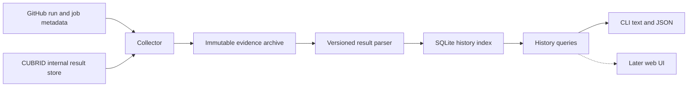

# CUBRID TC Chronicle: project design

Status: proposed design. Date: **2026-10-16**. Delivery target: **CLI first, with a web UI later**, as selected by the user. The working CLI name is `tcc`.

## 1. Product decision

Build a local evidence index of CUBRID testcase outcomes across CI runs and engine commits. Query that index by testcase path, filename, ticket fragment, run, or commit.

Separate collection from queries. `tcc sync` retrieves available evidence. `tcc history` and `tcc explain` read a consistent local snapshot without contacting GitHub. This makes repeated queries fast and preserves results after upstream retention removes them.

The central record is an **observed testcase outcome**, tied to the engine revision actually tested. A failed workflow, red commit status, or CTP exit code does not by itself establish a failed testcase.

### Questions the first version answers

1. Where and when did this testcase fail?
2. Which distinct engine commits contain observed failures?
3. Did the testcase fail before this particular occurrence?
4. Did it also pass, including after a retry on the same revisions?
5. Are earlier failures from comparable contexts or other branches/configurations?
6. What evidence supports the result, and what history remains unknown?

### Initial scope

Support `gha-ci` SQL, medium, and shell results for `CUBRID/cubrid`. Use GitHub for discovery and CUBRID's internal result store for detailed evidence. Start with the accessible recent window, then retain new evidence continuously.

CircleCI history, QA-portal history, unit tests, automatic bug attribution, CI triggering, and a shared web application are later work. Their absence must appear in coverage output. The first version can therefore answer questions about indexed GHA history, rather than all historical CUBRID testing.

## 2. Evidence that changes the design

These facts were checked against the workflow and one live failed run. Full references and inspection limits are in [CUBRID evidence](cubrid-evidence.md).

| Finding | Design consequence |
|---|---|
| Detailed results live on an internal HTTP server | GitHub artifact downloads alone cannot build the index |
| The workflow says run directories expire after 30 days | Archive small verdict and provenance files promptly |
| A comment-triggered run's workflow SHA differs from its tested engine SHA | Store both SHAs and resolve the tested SHA from build evidence |
| SQL/medium publish leaf results in `summary_info` | Parse individual verdicts and exclude aggregate directory rows |
| Shell publishes JUnit and aggregate counters | Parse JUnit outcomes and reconcile them with counters |
| A SQL plan can name a directory containing many tests | Do not treat selected units as executed testcase results |
| The same external run directory is reused across attempts | Preserve snapshots and attribute results to jobs only when evidence supports it |
| CTP can return zero when cases failed | Read verdict evidence rather than process exit status |

GitHub provides no testcase-path search over these files. Its discovery, attempt, pagination, and retention constraints are summarized in [GitHub evidence](github-evidence.md).

## 3. Meaning of “new” and “happened before”

Use three separate dimensions: **history**, **comparison context**, and **coverage**. A prior failure is useful even when the available history is incomplete.

### History result

The target is a selected failure occurrence. Prior means an execution ordered before that occurrence by recorded execution time or job completion time. Commit timestamps do not establish that order.

| Result | Required evidence | User-facing meaning |
|---|---|---|
| `SEEN_BEFORE` | At least one earlier failure for the resolved testcase identity in the requested scope | This testcase failed before. Show the earliest and most recent matches |
| `FIRST_OBSERVED_IN_WINDOW` | Target is a verified failure, no earlier indexed failure matches, and discovery plus relevant result coverage is complete for the stated window | This is its first observed failure in that window |
| `UNKNOWN_HISTORY` | No prior match, with incomplete discovery, missing results, unresolved identities, or uncertain ordering | The available history cannot establish whether it failed before |

Always print the window, source scope, synchronization time, and number of prior verified executions. If there are no prior executions, say so. A fully indexed window may contain few tests of this testcase.

“Complete” means complete for retained, discoverable runs of the configured source within the declared window. Upstream deletions before initial indexing can remain undetectable. Record this limitation separately. Never convert `FIRST_OBSERVED_IN_WINDOW` into “first ever,” “introduced by this commit,” or “confirmed regression.”

Without an explicit target, `history` lists all indexed occurrences. Its summary anchors to the latest indexed failure and names that choice. `explain` accepts a run and testcase to anchor a particular investigation.

### Comparison context

Report earlier matches in these groups:

- Ancestors of the target engine commit, when commit ancestry is available.
- The same PR or branch, with the recorded historical reference.
- Other branches or unrelated commit lineages.

For each match, compare testcase revision, CTP revision, build mode, platform, effective configuration, and known execution variants. Missing values mean **unknown**, not equal. Exact agreement establishes a comparable recorded context. Differences or missing values remain visible rather than suppressing a useful path match.

A failure on another branch establishes previous occurrence. It does not establish that the target's ancestors already contained the defect. A passing execution followed by a failure gives an observed interval to investigate. It does not identify the introducing commit.

### Testcase recurrence versus symptom recurrence

The default question is whether the same testcase failed before. An optional failure fingerprint groups similar failure messages for that testcase.

Keep the raw message and a versioned normalization rule. Remove only demonstrated volatile fields. Preserve SQL literals, error codes, assertion names, and meaningful stack frames. Missing or different fingerprints do not erase testcase recurrence. Fingerprint equality suggests a similar symptom, not a proven shared cause.

If the same engine, testcase, tooling, and recorded environment show both pass and fail outcomes, report **inconsistent observed outcomes**. Mark a possible intermittent failure. Do not declare a testcase flaky solely from failures on different revisions or unknown environments.

## 4. Testcase identity

Use `(testcase_repository, suite, repository_relative_path, execution_variant)` as the logical identity. Store testcase revision separately, so history remains searchable across revisions.

Canonical example:

```text
repository: CUBRID/cubrid-testcases
suite: sql
path: sql/_36_guava/cbrd_27461/cases/cbrd_27461.sql
variant: recorded configuration, or explicitly unknown
```

Normalize documented runner roots and repository prefixes. Preserve case and the full `cases/...` suffix. Reject traversal paths. Keep the original identifier beside the canonical one.

`find` accepts exact paths, filenames, suffixes, and ticket fragments. It returns candidates rather than merging ambiguous names. SQL and medium files with the same basename remain distinct. Unknown execution variants cannot silently become known variants.

Renames require an explicit alias with repository, revision interval, and evidence. Git history can suggest an alias, but a matching basename or similar content cannot automatically join two histories. Show testcase revision changes in every timeline. Later content hashes can establish that files match across different repository commits, while shared fixture and answer changes remain relevant.

## 5. CLI experience

These commands are proposed. They are not implemented.

```sh
# Import a bounded recent window. Repository and store come from local config.
tcc sync --since 2026-09-16 --until 2026-10-16

# Resolve a name, ticket fragment, or pasted path.
tcc find cbrd_27461

# Show distinct failed engine commits, plus linked execution occurrences.
tcc history sql/_36_guava/cbrd_27461/cases/cbrd_27461.sql

# Decide whether this particular failure occurred before.
tcc explain --run 38868725373 --suite sql \
  --case sql/_36_guava/cbrd_27461/cases/cbrd_27461.sql

# Limit comparison to known ancestors of a selected engine revision.
tcc history sql/_36_guava/cbrd_27461/cases/cbrd_27461.sql \
  --ancestor-of b74043dfabe0ad36ee4939353a8848a939f90184 --json

# Inspect collection gaps and import one available run explicitly.
tcc coverage --since 2026-09-16 --until 2026-10-16
tcc sync --run 38868725373
```

Support filters for suite, time window, PR, recorded branch, engine SHA, pass/fail outcome, and fingerprint. All-scope queries include other branches and explain that scope. An ancestry filter reports unresolved ancestry rather than assuming unrelated commits.

Branch filters use the historical engine reference when evidence establishes it. The workflow branch and testcase branch are separate fields. An `issue_comment` run on the default workflow branch must not automatically become a test of `develop`. Unknown historical references stay unknown.

The `history` summary counts distinct failed engine SHAs. The detailed timeline lists every underlying execution, retry, and evidence link. A successful retry does not remove an earlier failure. The first version can provide a `--commits` view and a `--runs` view over the same records.

Illustrative output, with invented counts and earlier commits:

```text
SEEN_BEFORE: 4 earlier failures on 3 engine commits
Target: run 38868725373 / sql / engine b74043dfabe0
Window: 2026-09-16 through 2026-10-16 UTC
Scope: indexed gha-ci runs, all branches
Coverage: partial; 2 relevant run results unavailable

Completed UTC        Engine        TC revision   Outcome  PR    Run
2026-10-16 08:01     b74043dfabe0  d54fe412eff5  FAIL     8001  38868725373
2026-10-14 09:10     <earlier SHA> <TC revision> FAIL     ...   ...

Earlier match: another branch, testcase revision changed
Same symptom: unavailable
Last synchronized: 2026-10-16 09:15 UTC
```

The real sample is documented separately. No earlier failure count for that sample was established during this design.

JSON includes a schema version, resolved identity, selected target, history result, comparison groups, coverage, synchronization time, and source references. An unknown result is structured data, not a command error. Exit codes distinguish successful queries, ambiguous identity, and operational errors. An empty match set remains a successful query with explicit coverage.

## 6. Architecture and module interfaces

Use Python 3.12 or later, SQLite, and a filesystem archive of compressed evidence. Start with a packaged CLI using the standard argument parser. External dependencies can be chosen during implementation after the parser spike.



Keep these modules deep, with small interfaces:

| Module | Interface | Implementation hidden behind it |
|---|---|---|
| Collection | `sync(scope) -> SyncReport` | Pagination, discovery overlap, request budgets, provenance retrieval, retries, and raw snapshots |
| Result parsing | `parse(bundle) -> ParsedExecution` | Suite grammars, identity normalization, duplicate handling, counters, and diagnostics |
| History index | `ingest(parsed_execution) -> Receipt` | Transactions, idempotence, schema migrations, references to retained evidence |
| History query | `history(query) -> HistoryReport` | Target selection, recurrence, ancestry, comparison context, and coverage rules |

The CLI formats reports and translates arguments. It contains no recurrence policy. A future web UI uses the same query interface.

Place transport seams at the actual sources: GitHub metadata and the internal result store. Recorded HTTP responses provide replay adapters for tests. Do not build a general CI-provider plugin framework before a second provider is implemented.

Use one ingestion writer and SQLite WAL mode so queries can read during synchronization. Publish each parsed execution atomically. Queries name an index generation and never combine half-imported records.

## 7. Data model

Store immutable observations and derive summaries. Keep unknown values explicit.

| Record | Key data and purpose |
|---|---|
| `repository` | Stable source identity and canonical slug |
| `ci_run` | Provider, repository, run ID, event, workflow revision, trigger SHA, historical PR/ref values with evidence quality, timestamps, and original URL |
| `ci_job` | Run ID, attempt, job ID, suite/shard when resolved, lifecycle, and conclusion |
| `execution` | Actual result-producing job or unresolved result snapshot, engine SHA, testcase SHA, CTP SHA, variant/configuration, and provenance quality |
| `testcase` | Logical identity and original identifiers |
| `observation` | Execution, testcase, invocation ordinal when known, explicit outcome, duration, fingerprint, and evidence location |
| `execution_plan` | Selected units, any expanded testcase inventory, expected counts, and excluded or unhandled units |
| `evidence_snapshot` | Source location, retrieved time, content hash, retained object path, byte length, parser version, and availability |
| `coverage_record` | Discovery window or execution, coverage kind, completeness, reason, and last verification time |
| `commit_parent` | Engine commit and parent SHA, with retrieval status, for ancestry queries |
| `testcase_alias` | Explicit rename mapping, applicable revisions, and supporting evidence |

An execution must not invent an attempt when the external snapshot cannot establish one. Preserve the known run, snapshot time, and unknown attempt instead. If the engine SHA cannot be established, retain a failure as unresolved provenance and exclude it from confirmed per-commit counts.

Suggested indexed lookup keys:

- Testcase identity, basename, and path suffix lookup support.
- `(testcase_id, outcome, execution_time)` for timelines and prior failures.
- Engine SHA and testcase SHA for revision comparisons.
- `(provider, repository_id, run_id, attempt, job_id)` for job identity.
- Source location plus content hash for snapshot identity.
- A partial failure index for fast failure-only lookup.

Store every explicit outcome in the initial implementation, including passes and skips. Batch inserts and avoid repeated large messages in observation rows. Keep raw messages in the evidence archive.

The observed sample contains 17,571 selected SQL cases. At that size, 1,000 full runs imply roughly 17.6 million SQL outcome rows. Measure row/index size and import/query latency in the pilot. If necessary, later move pass records into compressed execution blocks while retaining searchable failure records. This requires evidence-equivalent queries, not a change in history semantics.

## 8. Collection and parsing

### Discovery and synchronization

1. Enumerate configured workflows across a closed creation-time window. Include successful, failed, canceled, and skipped runs.
2. Follow pagination. Split windows that approach GitHub's filtered-search cap. Deduplicate intersecting windows by run ID.
3. Enumerate attempts and jobs, rather than only the latest jobs. Identify runs with actual suite execution.
4. Fetch small result and provenance files from the configured internal store. Record retrieval failures individually.
5. Archive raw bytes by content hash before parsing. Retain the source revision and parser version.
6. Parse and reconcile outcomes, then atomically import an execution or a quarantined diagnostic record.
7. Advance discovery coverage only after every page is accounted for. Track result coverage independently.

Use a recent overlapping discovery window for new runs, plus an explicit revisit queue for in-progress runs, changed attempts, missing files, and recent completed runs. Creation-time discovery alone misses retries of older run IDs.

Separate the discovery watermark from result ingestion progress. A temporarily inaccessible result does not require redownloading every metadata page. Honor GitHub request headers and retry budgets. Do not permanently label a `404` as expiration without supporting evidence.

Manual `sync` is sufficient initially. Recommend an hourly invocation on a host with internal-store access, installed only when requested. Completed runs receive a second consistency check. The polling interval is a retention measure and cannot guarantee capture before a rapid rerun overwrites results.

### Source and outcome rules

- Prefer individual SQL/medium verdicts in `summary_info` and shell testcase outcomes in JUnit.
- Treat `collect/failed.list` as a useful failure source and reconciliation input. Its absence is not a pass.
- If only a full failure list survives, ingest positive failure evidence with partial coverage. Do not infer outcomes for other tests.
- Ignore aggregate summary rows. Collapse repeated records only when the parser can establish they repeat the same invocation.
- Preserve retries as separate invocations when the format identifies them. If order or identity is ambiguous, retain the conflict and mark coverage partial.
- Reconcile individual counts with shard counters, planned counts, and completion markers. Contradictions produce diagnostics rather than silent precedence.
- Represent `PASS`, `FAIL`, `SKIP`, `ERROR`, and `NOT_RUN` separately. Keep the original runner verdict. Emit `NOT_RUN` for a specific testcase only when the plan/inventory proves it was selected and did not execute.
- An unexpanded SQL directory plan supports an unhandled unit/count, not invented per-case `NOT_RUN` records.
- Distinguish job infrastructure errors from explicit testcase errors. A crash can be a testcase failure if case-level evidence establishes it.

For engine provenance, read what each shard consumed from `build.read`. Use `tc.read` for the testcase revision. Preserve plan values separately and flag disagreement. Resolve CTP revision from the plan job's recorded output/log evidence or another revision-bearing source, otherwise keep it unknown. Never read current PR heads as historical proof.

### Attempts and mutable artifacts

An external directory is a snapshot, not an immutable workflow attempt. Preserve an execution attribution quality of `verified`, `partial`, or `unresolved`, with reasons.

Use an actual job ID or explicit result-producer metadata when available. `build.read.run_attempt` describes the build producer and cannot identify the testcase execution attempt. Multiple content hashes at the same URL remain separate snapshots. Stable bytes observed twice improve fetch consistency but do not prove attempt identity.

If an old result was overwritten before collection, retain that gap. Do not replicate the current result across every enumerated attempt. A later green rerun does not delete archived failure observations.

### Retention and reprocessing

Retain provenance, verdict files, plans, and discovery coverage by default. Download large debug/core archives only on an explicit evidence request. Keep their source references and availability metadata regardless.

Place the database and archive under the user's local data directory, outside the source tree. Cache credentials through the existing authenticated environment and keep them out of records. Retained private testcase evidence keeps the same local access restrictions.

Reparse retained evidence with a new parser version without contacting upstream. Select one validated parse generation for queries. Reprocessing the same snapshot is idempotent. Archive replacement and database import must be crash-recoverable, with checksums verified before an execution becomes visible.

## 9. Coverage and correctness rules

Every report includes a coverage block:

```text
Requested source/window
Enumerated runs and pagination completeness
Relevant executions with complete / partial / unavailable results
Verified prior executions of this testcase
Unresolved identities, revisions, and attempt attributions
Excluded providers and earliest retained evidence
Last successful synchronization and index generation
```

The design maintains these invariants:

1. A failed testcase requires case-level failure evidence.
2. A passing testcase requires case-level pass evidence.
3. No missing record becomes a pass or proof of novelty.
4. Every displayed failed commit points to revision-bearing evidence.
5. A retry cannot erase an earlier observed failure.
6. Unknown variants and revisions do not establish context equality.
7. Unknown ancestry does not establish branch independence or parentage.
8. Every classification can be reconstructed from retained evidence and its parser/query versions.

Unknown-result reasons include `not_indexed`, `source_unreachable`, `access_denied_or_missing`, `expired_confirmed`, `parse_unsupported`, `count_mismatch`, `attempt_unresolved`, and `provenance_conflict`. Keep specific reasons rather than one generic “no data.”

## 10. Delivery plan and acceptance

| Step | Deliverable | Acceptance evidence |
|---|---|---|
| 1. Evidence spike | Recorded fixtures and parsers for all three suites | One failed and one successful sample per suite, plus a partial rerun and an incomplete shard |
| 2. Durable import | SQLite schema, evidence archive, and `sync --run` | Real failed SQL sample imports with actual engine SHA, testcase revision, and linked raw verdict |
| 3. Local queries | `find`, `history`, `explain`, JSON, and `coverage` | A seeded multi-run history correctly distinguishes recurrence, first-observed-in-window, and unknown |
| 4. Backfill and incremental sync | Date-window discovery, pagination, revisit queue, and resumable imports | Overlapping/repeated sync creates no duplicate observations and revisits an older rerun |
| 5. Pilot | Recent accessible GHA history and measured performance | Review real recurring failures, inspect gaps, measure archive growth, and benchmark lookup |
| 6. Older sources | CircleCI adapter, then QA evidence if needed | Separate provider fixtures and explicit coverage before those histories join classifications |
| 7. Web UI | Read-only testcase search and timeline | Uses the same query interface and preserves evidence links and coverage text |

Target local performance: a testcase history query returns within one second against ten million observations on the chosen deployment host. This is an acceptance target to measure, not a current benchmark. Backfill speed depends on available evidence and request budgets.

Use recorded evidence for meaningful end-to-end tests through import and query interfaces. Required scenarios include:

- Wrong trigger SHA, unknown historical engine references, and the same basename across suites.
- Testcase revision changes and an earlier failure followed by a green retry.
- Expired evidence, missing pass evidence, conflicting counts, and unknown ancestry.
- Duplicate imports and interrupted imports.

Test versioned fingerprints separately from testcase recurrence.

The first usable release ends after step 5. The design deliverable does not authorize deployment, scheduling, publishing, CI modification, or implementation.

## 11. Optional CI improvement

After the collector proves useful, propose a small versioned manifest written by each result-producing job:

```text
run_id, run_attempt, job_id, suite, shard
engine_sha, testcase_repository, testcase_sha, ctp_sha
configuration_digest, started_at, completed_at
selected_count, executed_count, passed_count, failed_count, skipped_count
result_locations_and_hashes, rerun_source
```

Write results under immutable run/attempt/job paths. Preserve original job references when a later rerun reuses earlier successful shards. An aggregate manifest can link those executions without claiming they all ran again.

This improves evidence quality and collection cost. Chronicle can begin with the existing result files and must continue to report historical limitations honestly.
