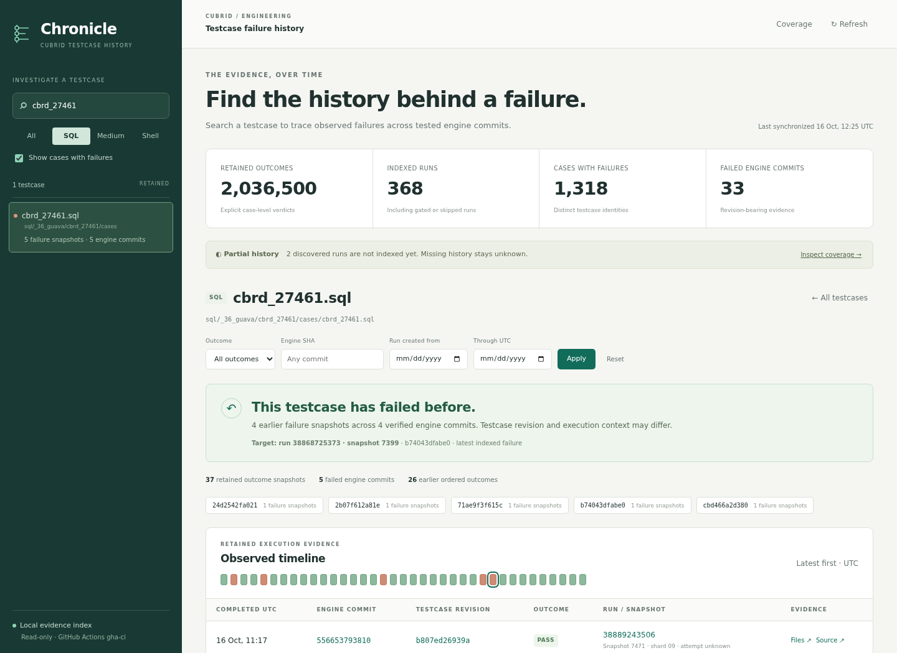

# Chronicle web UI

Version: **0.3.0**. The web UI reads the same retained evidence and history policy as the CLI.



The [expanded validation report](history-expansion.md) records the collected corpus, source checks, coverage gaps, and browser verification.

## Start and open

From the Chronicle checkout:

```sh
just setup
just serve
```

The server listens on all IPv4 interfaces and also on IPv6 when dual-stack support is available. It prints an access URL for each usable address on active interfaces, including LAN, VPN, secondary addresses, container bridges, and loopback. Each URL includes its interface name and the selected port. Wildcard bind addresses, inactive interfaces, and link-local addresses are excluded from the list. Linux's `ip` command from `iproute2` is required for address discovery.

Requests accept the printed IP addresses and the `localhost` alias. Restart the server to refresh this list after interface addresses change.

Open a printed LAN or VPN URL from a computer that can reach that interface. Each URL contains a temporary token. The server exchanges that token for a session cookie and removes it from the document URL. Each server start creates a new token. The cookie is HTTP-only and uses SameSite Strict. The server does not open a browser automatically.

For loopback-only access:

```sh
just serve-local
```

This mode binds to `127.0.0.1` and works without interface discovery. Its direct CLI equivalent is `uv run tcc serve --local`. The default `uv run tcc serve` uses all interfaces, like `just serve`.

Both recipes accept `--port`. Use the global `--data-dir` and `--repository` options through `just tcc` to select the index and repository:

```sh
just serve --port 8877
just serve-local --port 8877
just tcc --data-dir /path/to/index serve --port 8765
```

For optional SSH forwarding, run `just serve-local` on the remote Linux host. On your own computer, replace `HOST` below with that server's SSH name:

```sh
ssh -N -L 8765:127.0.0.1:8765 HOST
```

Then open the printed access URL in your computer's browser. Keep both commands running while you browse. Press Ctrl+C to stop them. The local forwarding port can differ from the server port. Adjust the browser URL's port in that case.

## Investigate a testcase

1. Search by ticket, filename, or path. Select a suite when useful. Clear **Show cases with failures** to include testcases with only passing or skipped evidence.
2. Select a full testcase identity. Distinct paths, suites, and execution variants keep separate histories.
3. Read the recurrence result. `SEEN_BEFORE` requires earlier case-level failure evidence. Partial or unordered history remains unknown when no earlier failure is established.
4. Inspect the timeline. Each row shows the tested engine SHA, testcase revision, outcome, PR details, run, and retained snapshot. PR details include the number, title, author, base branch, and head branch. The target summary shows the same details, with links to the PR and author. The default target is the latest indexed failure. Later passes remain visible.
5. Select **Use as target** on another failure to investigate that occurrence. Outcome, engine SHA, and UTC run-creation dates filter the query. Reset clears the filters and explicit target.
6. Open **Files** to inspect retained evidence. **Retained bytes** reads and verifies the archived object. **Original source** opens the upstream URL, whose bytes can change after reruns.

The timeline displays completion times in UTC. Date filters select runs by creation time, matching CLI discovery. Unknown completion times appear as **Order unknown**. A newer passing observation does not remove an earlier failure.

PR links identify the CI run's association. They do not establish that the PR caused the failure. Chronicle obtains the author from PR metadata. The person who triggers or reruns CI can be different. Unknown associations and unavailable authors remain visible.

**Base** names the PR's destination branch. **Head** names its source branch. These names reflect the last successful metadata refresh. They do not establish the historical tested engine reference or change branch filters. Missing titles and branch names remain explicit.

On desktop, the timeline uses a comparison table. On narrow screens, each row becomes a card with outcome, revisions, run, and evidence controls. The small outcome strip summarizes recent retained observations. Selecting a marker opens its evidence files.

The document URL preserves testcase, variant, filters, and an explicit target. Browser Back and Forward restore those selections. A saved document URL still requires an authenticated browser session. Use the new access URL after restarting the server.

## Coverage and collection

Open **Coverage** to inspect the selected window, discovery completeness, missing runs and shards, unavailable source files, and unresolved provenance. It also names providers outside the collected scope. Snapshot counts describe retained evidence. They do not establish an exact execution count when invocation or attempt identity is unresolved.

The web UI is read-only. Continue collection in another terminal:

```sh
uv run tcc sync-data --since 2026-10-14 --until 2026-10-16
```

For existing history, retrieve PR titles, authors, and branch names without downloading testcase results:

```sh
just sync-data --pr-metadata-only
```

New collections include PR details automatically. The [CLI guide](cli.md#collection) describes association evidence, lookup failures, and retained author details.

Use **Refresh** to read the latest committed index. It does not start synchronization. Each HTTP query uses a read-only SQLite transaction. Queries remain available while collection writes a new snapshot.

If an index does not exist, the page explains that `tcc sync-data` is required. After initialization, Refresh can read it without restarting the web server.

## Parser correction in 0.2

The broader collection exposed a version 1 error: missing shell verdicts could become `NOT_RUN` observations from a selection plan. A selected testcase may have executed even when its result file is unavailable. Parser version 2 records a coverage gap for that uncertainty. It preserves explicit passes, failures, errors, and skips.

```sh
uv run tcc reparse
```

Reparse retains the original evidence and older parse records. It atomically selects the current parser's observations for queries. Missing counters now report unavailable evidence, rather than unsupported grammar. A later consistency check can establish ordering for an unchanged snapshot after its sole job completes. The earlier provenance object remains retained. The build producer's attempt still cannot identify the testcase execution attempt.

## HTTP interface and verification

The browser uses these read-only routes after session authentication:

| Route | Result |
|---|---|
| `GET /api/overview` | Counts and evidence coverage |
| `GET /api/cases` | Paged testcase identities and failure counts |
| `GET /api/history` | The same history report as CLI queries |
| `GET /api/coverage` | Discovery and result gaps |
| `GET /api/evidence?execution=ID` | Retained file names and source references |
| `GET /api/evidence?execution=ID&file=NAME` | Checksum-verified raw bytes |

Catalog requests accept `q`, `suite`, `failed_only`, `offset`, and `limit` from 1 through 100. History requests accept testcase, suite, variant, target, outcome, engine, branch, PR, and run-creation dates. The web adapter accepts no local filesystem path from the browser. It exposes no collection or mutation route.

JSON reports use schema version 1. Ambiguous identities return HTTP 409 and candidates. Invalid filters return 400. Unauthenticated requests return 401. An unavailable index returns 503. Unknown history is a successful 200 response with its reasons.

Run the Python checks and optional browser verification:

```sh
just test
just browser-setup
just browser-check
just browser-check --lan
```

The browser check starts its own temporary server, uses headless Chromium, and stops both afterward. By default, it uses loopback. The `--lan` check binds all interfaces and opens the page through an active LAN or VPN address. It exercises real indexed `cbrd_27461` history, PR and author display, target selection, browser Back and Forward, date and outcome filters, evidence, coverage, deep-link reload, empty search, and mobile layout. Its JSON result includes screenshot paths. This check requires collected history for that testcase. Browser dependencies remain optional. Ordinary serving uses only Python's standard library, the packaged HTML, CSS, and JavaScript, and `iproute2` for LAN address discovery.
